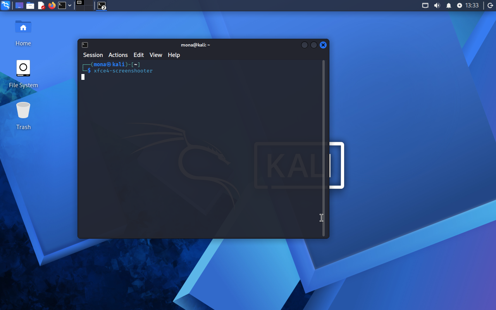
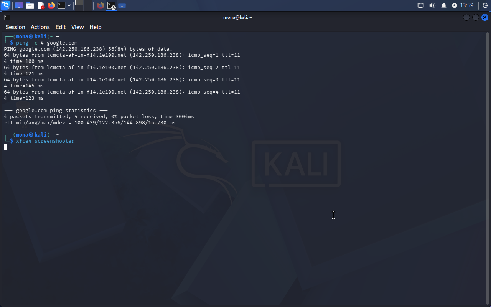
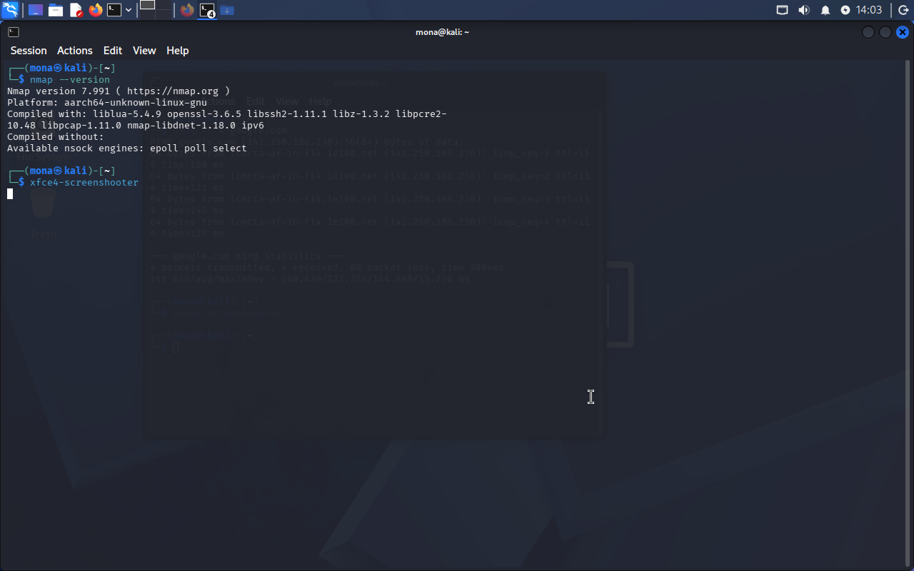

# Week 1: Kali Linux Setup and Network Connectivity

## Objective
To set up a Kali Linux virtual machine and become familiar with the Linux environment and basic network configuration.

## Environment
- Operating system: Kali Linux 2026.3
- Architecture: ARM64 (aarch64)
- Virtualization: Oracle VirtualBox
- Desktop environment: Xfce

## Activities Completed

### 1. Kali Linux Installation
- Installed Kali Linux in a VirtualBox virtual machine.
- Configured the virtual machine with 4 GB RAM, 2 CPUs, and a 40 GB virtual disk.
- Successfully booted into the Kali Linux desktop.

### 2. Network Configuration
- Checked the network interface using nmcli device status.
- Identified eth0 as the Ethernet interface.
- Confirmed that the virtual machine had network connectivity.

### 3. Connectivity Test
Used the following command:

ping -c 4 google.com

The test returned four successful replies with no packet loss.

### 4. Network Configuration Setting
Applied the instructor's configuration command:

sudo nmcli connection modify "Wired connection 1" ipv4.dad-timeout 0

Verified the setting using:

nmcli connection show "Wired connection 1" | grep ipv4.dad-timeout

The output confirmed that the value was set to 0.

## What I Learned
- How to install and run Kali Linux in a virtual machine.
- How to identify network interfaces.
- How to check network connectivity using ping.
- How to inspect NetworkManager connection settings.

## Reflection
This activity helped me become more comfortable with Kali Linux and the Linux terminal. I also learned how to verify network connectivity and apply a network configuration setting.

## Screenshots

### Kali Linux Desktop

### Network Connectivity Test

### Nmap Installation

---
Documented as part of my cybersecurity learning journey.
